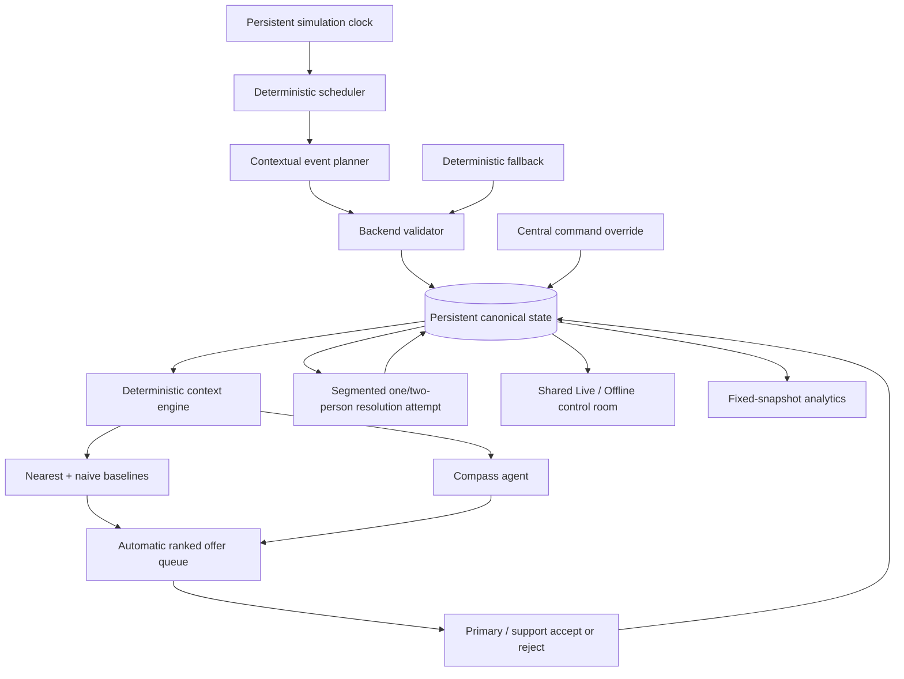

# ResponseCompass

**Not just who's closest. Who makes the most sense.**

ResponseCompass is a context-aware responder-dispatch agent inside a persistent simulated control room. An existing operational system decides what needs attention; Compass automatically finds who should respond to each issue right now.

The governing boundary is:

> Code establishes the evidence. Compass ranks the match. Responders accept asynchronously. Central command may override.

## Nebius Token Factory and NVIDIA Nemotron

ResponseCompass runs its model roles on **NVIDIA Nemotron models served by Nebius Token
Factory** (OpenAI-compatible API, `https://api.tokenfactory.nebius.com/v1`). Each role has
its own model, thinking setting and timeout, chosen from live measurements on the app's own
requests ([docs/nebius/05_TOKEN_FACTORY_FACTS.md](docs/nebius/05_TOKEN_FACTORY_FACTS.md)):

| Role | Default model | Thinking | What it does |
|---|---|---|---|
| Compass ranking (responders, fixes, overtime options) | `nvidia/nemotron-3-super-120b-a12b` | off | Ranks only the eligible candidates code supplies, with qualitative tradeoffs. |
| Investigator (in development) | `nvidia/Nemotron-3-Ultra-550b-a55b` | on | Investigates a free-text field report with read-only tools and cited past cases. |
| Event planner, narrator | `nvidia/Nemotron-3_5-Lightning` | off | Proposes the next simulated event; writes simulated field reports. |

Token Factory made the agent practical to run live: a ranking returns in about 3 s
(the previous provider took 20–60 s), native tool calling works on every Nemotron model,
and per-model pricing and limits are published in the model catalog. Every model output is
validated by application code. If a call is slow, invalid or unavailable, a deterministic
path takes over, so dispatch never stops. AMD Token Factory remains selectable in
Settings. Changes made for this hackathon are listed in [HACKATHON_CHANGES.md](HACKATHON_CHANGES.md).

Set `NEBIUS_TOKEN_FACTORY_API_KEY` (or `NEBIUS_TOKEN_FACTORY_API_KEY_FILE`); see
[.env.example](.env.example). Live mode spends Nebius credit. Offline mode and both test
suites make no model calls.

## Live demo

The hosted Nebius demo URL is added here when it is deployed (plan N8). A running room
pauses itself after 10 minutes with nobody using it, so an unattended tab does not spend
tokens. **Offline Demo** replays a fixed scenario with no API calls.

ResponseCompass was first built for an earlier AMD hackathon; that submission's media
remain in [docs/submission/](docs/submission/). What is new for Nebius is listed in
[HACKATHON_CHANGES.md](HACKATHON_CHANGES.md).

This is a synthetic project. It contains no proprietary facility context, real personnel
data, or production credentials.

## What is implemented

- persistent simulation clock with pause/resume; the UI offers 1× and 5× (the API also accepts 10× and 60×);
- deterministic one-shot scheduler with bounded cadence and no restart catch-up;
- a dedicated Demo view with visible agent activity and Trigger Next Event / Force Resolve controls;
- a default 2D manufacturing-floor map with three-floor selection, drag pan, wheel/button/keyboard zoom, and an optional 2.5D overview;
- contextual structured event planner plus deterministic seeded fallback;
- up to three concurrent issues, one or two exclusive responders per issue, waiting behavior, and stale protection;
- automatic support matching for complex or delayed work, plus roster-versioned central release and cross-issue transfer;
- hidden per-responder/per-class simulation truth blended with confidence-weighted same-class history for stochastic resolution outcomes;
- runtime resolution history, success, failure/reopen, responder release, and downtime tracking;
- bounded live Compass context with nearest and auditable naive-score baselines;
- revision-safe structured Compass results, automatic offer/accept/reject dispatch, central override, and audit records;
- persistent event feed with explicit baseline-disagreement markers;
- clickable, on-demand issue audit trails with complete Compass analysis, offer history, control-center overrides, and resolution actions;
- fixed-snapshot P0 analytics with denominators and thin-sample safeguards;
- API-free deterministic Offline Demo using the same offer/accept and override interaction;
- 341 hermetic unit and integration tests (including a 100-opportunity deterministic soak) and 73 Chromium E2E tests.

## Architecture



Application code owns time, facts, eligibility, metrics, baselines, validation, simulation outcomes, and all mutations. Models may only propose one bounded event or rank the eligible candidates supplied to them. Neither model sees `ResponderSkill`; the normal UI/API and analytics do not expose it either. See [architecture details](docs/architecture.md).

## Run locally

Requires Node.js 22+.

```sh
npm ci
npm run dev
```

Open `http://127.0.0.1:3000`. The server binds `0.0.0.0` by default for LAN demos; use `COMPASS_HOST` and `COMPASS_PORT` to override it. Live state persists under ignored `backend/data/` by default; set `COMPASS_DATA_DIR` to relocate all persistent application state. Simulation time does not advance while the process is stopped. A running room pauses itself after 10 minutes with no one using it (`COMPASS_IDLE_PAUSE_MINUTES`; `0` disables), so an unattended tab does not keep spending provider tokens.

The application reads an optional `.env` automatically:

```sh
cp .env.example .env
```

ResponseCompass uses one model provider: **AMD Token Factory** (OpenAI-compatible, `https://developer.amd.com.cn/radeon/api/v1`). Set the team key with `AMD_TOKEN_FACTORY_API_KEY`, or point `AMD_TOKEN_FACTORY_API_KEY_FILE` at a file containing only the key, and leave both Live modes set to `live`. The key stays server-side and is never sent to the browser. The default model is `MiMo-V2.6-Flash` with reasoning `none`. Without a key, or whenever AMD is slow, rate-limited, unavailable, or returns output that fails validation, Live event generation and responder matching fall back deterministically, so dispatch continues without a model response.

The Settings tab lets an operator save a key and pick another AMD model and reasoning level at runtime, without editing `.env`. See [Compass_AMD_Token_Factory_Integration_Guide.md](Compass_AMD_Token_Factory_Integration_Guide.md) for the service's limits and terms.

Offline Demo is always hard-pinned to the committed fixture, regardless of Live environment settings, and never makes an API request.

## Docker deployment

`compose.yaml` runs ResponseCompass as Compose project **`responsecompass`**: container
`responsecompass`, host port **3200** → container 3000, named volume
**`responsecompass-data`** at `/app/data`, `restart: unless-stopped`. The container runs as
the non-root `node` user with a read-only root filesystem, a `/tmp` tmpfs, all Linux
capabilities dropped and no-new-privileges. `.env` is read at runtime only and excluded
from the image. The AMD key never enters the image or `.env`: Compose mounts the host file
named by `AMD_TOKEN_FACTORY_API_KEY_FILE` in `.env` as a read-only secret at
`/run/secrets/amd_token_factory_key`, and the container reads it from there.

```sh
docker compose -p responsecompass up -d --build
docker compose -p responsecompass ps
```

The health check calls `GET /api/control-rooms` and passes only when every room reports
`READY`. These names are deliberately distinct from the older Compass deployment on the
same host (project `compass`, volume `compass-data`, port 3000); never point this file at
that volume. `docker-compose.yml` is a separate development setup (port 3100).

### Public access through Cloudflare Tunnel

The `cloudflared` service (container `responsecompass-tunnel`, running as uid 1000 so a mode-600 token file stays readable, pinned
`cloudflare/cloudflared:2026.10.1`) connects outbound to Cloudflare, so no host port is
opened. It runs only under the `tunnel` profile and starts after the app is healthy. The
tunnel token is mounted like the AMD key: a read-only secret from the host file named by
`RESPONSECOMPASS_TUNNEL_TOKEN_FILE`, read with `--token-file`, never placed in an
environment variable. In `.env`:

```sh
COMPOSE_PROFILES=tunnel
RESPONSECOMPASS_TUNNEL_TOKEN_FILE=/absolute/path/to/tunnel.token
```

In the Cloudflare dashboard, set the public hostname's service to
`http://responsecompass:3000` (the app's name on the Compose network, not `localhost:3200`).
The app has no login. Provider settings are therefore read-only for anyone arriving through
the tunnel (Cloudflare adds `Cf-Connecting-IP` to those requests): they see the Settings page
greyed out, and the server refuses changes. Change the key or models from
`http://<host>:3200` on the host or LAN. `COMPASS_PUBLIC_SETTINGS=editable` lifts this, for a
tunnel already behind Cloudflare Access.

### Switchover, data migration, and rollback

A room is a checkpoint file plus a change journal (see
`project-state/backend/live-runtime.md`), so always copy **whole directories**.

1. Pause the rooms and stop the non-container process on 3200; never run two writers
   against the same data.
2. Back up the complete `backend/data/` directory and verify the copy (`diff -rq`).
3. Create `responsecompass-data` and confirm it is **empty**; copy the data in once as root
   with a one-off container, then `chown -R 1000:1000`. Never copy into a non-empty volume.
4. `docker compose -p responsecompass up -d --build`; require `healthy`, every room
   `READY`, and the Settings credential reported as configured.

Rollback: `docker compose -p responsecompass down` (the volume is kept), then restart the
former process against the verified backup. Do not delete the volume as a rollback step.

## Demo controls

- **Resume / Pause** controls simulation time.
- **Speed** selects 1× or 5× without replacing the current timer. Live AMD rankings take about 40–90 seconds, so faster speeds outrun them; the API still accepts 10× and 60× for offline generation.
- **Demo** opens a dedicated activity monitor and keeps presentation-only shortcuts out of the normal operating controls. The navigation status pill remains visible while an agent is working.
- **Trigger Next Event** immediately executes the validated scheduler path and respects the active-issue ceiling.
- **Force Resolve** immediately consumes the selected assigned issue's one-shot token. The result still uses the normal skill/history probability and variability model; it bypasses waiting, not outcome logic.
- **Issue staffing** can request a second responder, release either member of a two-person roster, or transfer one responder from another two-person issue. Primary promotion is automatic and every roster change replans remaining work without rerolling the outcome.
- **Reset** resets only the active mode; switching to Offline does not erase Live history.

## Verification

```sh
npm test
npm run test:e2e
```

`npm test` includes contracts, persistence, clock/scheduler idempotency, planner fallback, multi-issue races, latent resolution, live recommendations, assignments, analytics, Offline reset, convergence, and a 100-opportunity soak.

Playwright may require Chromium system libraries. In this build environment the successful command was:

```sh
LD_LIBRARY_PATH=/home/makodev58/nebius-tools/libs/usr/lib/x86_64-linux-gnu npm run test:e2e
```

See [evaluation results and limitations](docs/evaluation.md). The deterministic policy proves state integrity and seed disagreement capacity; it is deliberately not presented as a live-model quality result. Genuine provider sign-off requires credentials and pinned model IDs.

## Analytics and ethics

Rates always include denominators and are suppressed as **Insufficient data** below three observations. **Issue-Class Experience** is alphabetically ordered, emphasizes cases, and is not an employee ranking. Compass excludes compensation, seniority, demographics, biometrics, personality, fatigue, disciplinary data, and general HR scoring. A responder with no prior issue-class history remains eligible.

## Operational diagnostics

The application persists up to 1,000 structured runtime log events in the ignored local data directory. Retrieve them with `GET /api/logs` or `GET /api/logs?limit=25`. Browser failures are reported to `POST /api/logs/client`.

## Source of truth

[`Compass_ResponseCompass_SOW_v4_FINAL.md`](Compass_ResponseCompass_SOW_v4_FINAL.md) is the product specification. Material implementation decisions are recorded in [docs/decisions.md](docs/decisions.md), agents coordinate through [handover.md](handover.md), and merged handoffs are archived in [docs/handover-history.md](docs/handover-history.md).

The generic control rooms are **e8-aura-p1** (`/rooms/plant-1`) and
**e8-aura-p2** (`/rooms/plant-2`). Compass ranks eligible responders from aggregate
simulated history; MES integration and case-guided response plans are not included.

## Evidence-based troubleshooting

Issues expose an observed symptom and a Recommended fix section with catalog procedures,
ranked order, observed evidence and an explicit AMD / deterministic / Offline-fixture
source. The applied procedure is frozen when work begins and affects the seeded simulated
outcome; failed work tries the next untried procedure. The incident planner's free-text
response remains a note, while audit entries record the fix actually applied.

Models never see latent fault causes, effectiveness tables or hidden responder skill.
First-time fix rates and recommendation/baseline agreement carry denominators; legacy
free-text actions are labelled and excluded from fix evidence. These are simulated
observations, not proof of improvement in a real facility.
