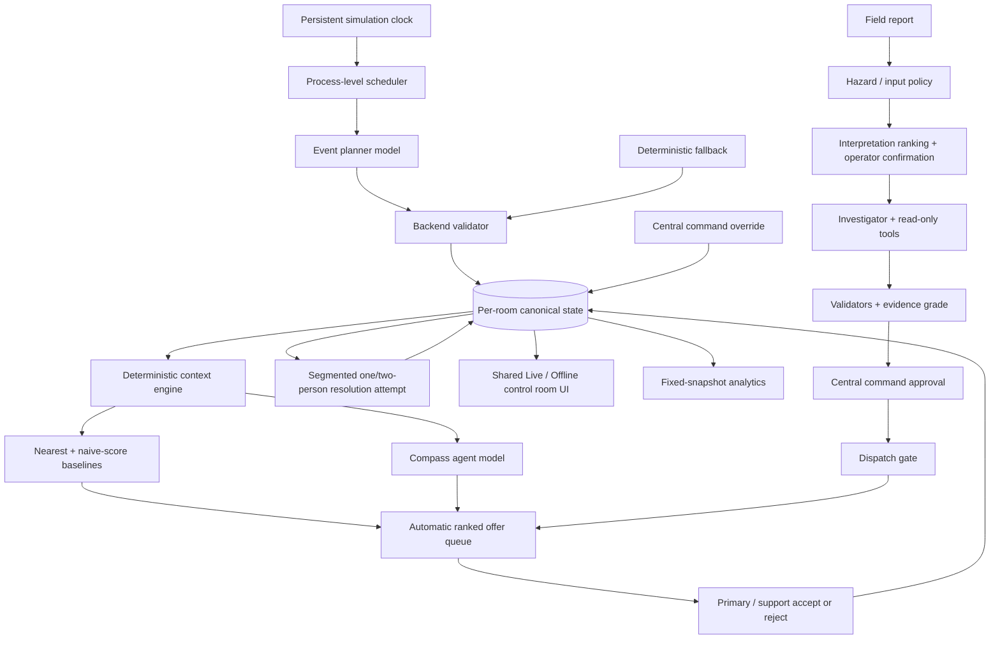

# Architecture — the whole system on one page

ResponseCompass is a **context-aware responder-dispatch agent inside a persistent simulated
control room**. An operational simulation decides what needs attention; Compass decides
*who* should respond to each issue, right now, and explains the tradeoff.

The governing sentence:

> Code establishes the evidence. Compass ranks the match. Responders accept
> asynchronously. Central command may override.

## The load-bearing boundary

**Application code owns facts; models only propose or rank within bounds.** This is the
single most important thing to preserve when changing ResponseCompass. See
[concepts/agent-boundary.md](concepts/agent-boundary.md).

- Application code owns: time, facts, eligibility, geometry, metrics, baselines,
  validation, simulation outcomes, and every state mutation.
- A model may only:
  - propose **one** bounded next event (the event planner);
  - **rank the eligible candidates or interpretations it is handed**, with qualitative
    tradeoffs (the Compass agent, fix, staffing and interpretation ranking);
  - **investigate a field report with read-only tools** (the Compass Investigator, since
    2026-10-19). Tool results are bounded public DTOs with a host-owned decision cutoff.
    Code validates every citation, fix and responder, computes the evidence grade and
    outcome, and a person approves through the single dispatch gate. See
    [backend/investigation.md](backend/investigation.md).
- Every model output is validated against a strict contract and is never trusted as
  authoritative. If a model is unavailable, invalid, or slow, the system falls back to a
  deterministic baseline and keeps running.

## Data-flow

## The major pieces

| Area | What it does | Wiki page |
|------|--------------|-----------|
| **Domain model** | The persisted state: issues, responders, equipment, assignments, attempts, events — and the hidden `ResponderSkill` simulation truth. | [backend/domain-model.md](backend/domain-model.md) |
| **Live runtime** | Drives real-time simulation: scheduler → planner → context → agent → dispatch → resolution. Calls real models. | [backend/live-runtime.md](backend/live-runtime.md) |
| **Offline runtime** | The same UI and dispatch math driven by committed fixtures. Makes no API calls, ever. | [backend/offline-runtime.md](backend/offline-runtime.md) |
| **Control Rooms** | Several fully independent simulations (`e8-aura-p1` / `e8-aura-p2`) in one deployment, each with isolated state. | [backend/control-rooms.md](backend/control-rooms.md) |
| **Model providers** | The one place provider mechanics differ (endpoint, credential, reasoning-field shape). | [backend/model-providers.md](backend/model-providers.md) |
| **Simulation mechanics** | Clock, scheduler, resolution engine, attempt engine, workforce continuity, responder location. | [backend/simulation.md](backend/simulation.md) |
| **HTTP API** | Every route the server exposes; room-scoped vs. deployment-global. | [backend/http-api.md](backend/http-api.md) |
| **Frontend** | A vanilla-JS single-page control room that polls state every 1.5s and renders the floor, panels, analytics, and settings. | [frontend/overview.md](frontend/overview.md) |

## Process shape

- **One Node process** serves the HTTP API and the static frontend from
  `backend/src/server.mjs`, binding `COMPASS_HOST` (default `0.0.0.0`) : `COMPASS_PORT`
  (default `3000`).
- **One control-room manager** (`control-room-manager.mjs`) composes a Live + Offline +
  application runtime *per room* and owns **one** process-level scheduler that ticks every
  `READY` room concurrently. There is exactly one timer for the whole deployment.
- **State persists** to JSON under the git-ignored `backend/data/` tree (one subtree per
  room). Simulation time does not advance while the process is stopped.
- **No framework, no database.** Node's built-in `http` server, a per-room JSON checkpoint plus
  fsynced change journal,
  and a vanilla-JS frontend. Node 22+ is required.

## Runtime dependencies

- Node.js ≥ 22 (uses `node:test`, `--env-file-if-exists`, built-in `fetch`).
- `@playwright/test` for the end-to-end browser suite (dev dependency only).
- Optional model providers reached over HTTP. Without any credentials the system still
  runs — Live model calls fail closed to deterministic baselines.

See [operations/running-and-config.md](operations/running-and-config.md) to run it and
[operations/testing.md](operations/testing.md) to verify it.
